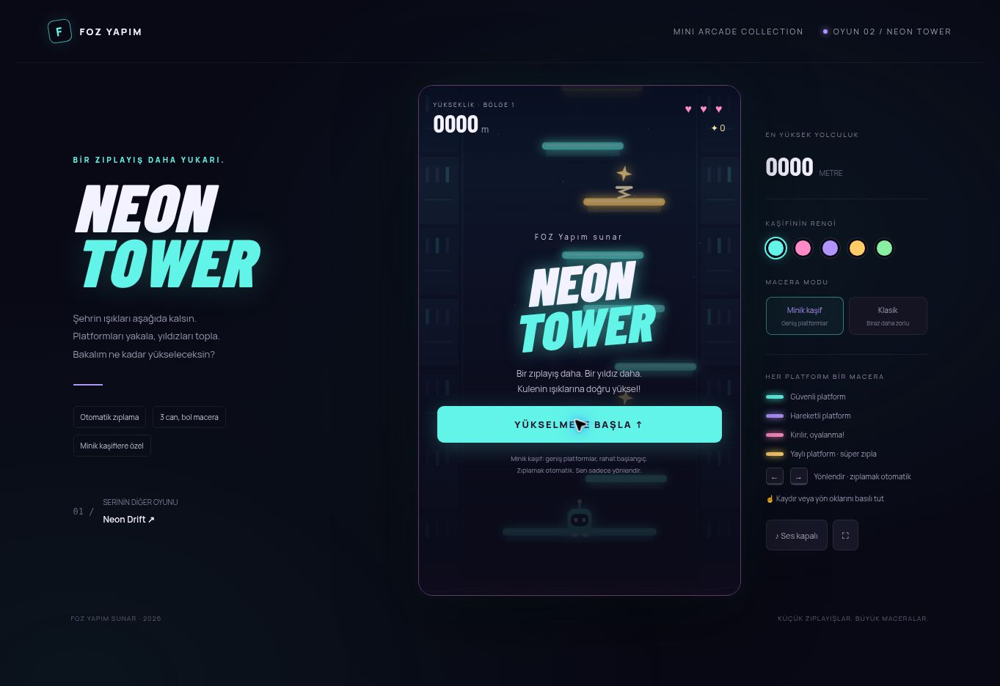

# Neon Tower

## [▶ TARAYICIDA OYNA](https://fozdemiroglu.github.io/neon-tower/)

**Oyuna başlamak için yukarıdaki bağlantıya veya aşağıdaki görsele tıkla.** İndirme, kurulum veya GitHub hesabı gerekmez. Telefonda ve bilgisayarda tarayıcıdan oynayabilirsin.

Otomatik zıplayan kaşifi yönlendir; hareketli, kırılan ve yaylı platformlarla yüksel.

---

FOZ Yapım sunar.

Otomatik zıplayan karakteri sağa ve sola yönlendirerek yükselin. Beş karakter rengi, Minik kaşif ve Klasik modları, hareketli, kırılan ve yaylı platformlar, yıldızlar ve üç can bulunur.

## 10. bölgeden sonra: Fırtına Zirvesi

900 metreyi geçince gökyüzü mora döner, şimşekler çakar ve oyun değişir:

- **Hayalet platformlar** (yeşil) yanıp söner. Kesik çizgiliyken üstüne basılmaz; bir önceki platformda zıplayıp zamanlamayı beklemek gerekir.
- **Drone'lar** havada sağa sola uçar. Üstlerine düşersen etkisiz kalırlar ve +2 yıldız verirler; yandan çarparsan aşağı itilirsin.
- **Roket** nadiren platformların üstünde çıkar ve seni birkaç saniye boyunca yukarı uçurur.
- **Rüzgâr** 11. bölgeden itibaren ara ara eser; önce ok ve uyarı çıkar, sonra seni yana iter.
- Her yeni bölgede platformlar biraz daralır, aralar açılır, hareketli platformlar daha hızlı ve geniş salınır, drone'lar çoğalır.
- 10. bölgeye ulaşınca canın eksikse bir can hediye edilir.

## Kontroller

- Bilgisayar: sağ ve sol yön tuşları.
- Telefon: dokunmatik yön kontrolleri.

Üç can bitince oyun sona erer. Yükseklik rekoru bu tarayıcıda saklanır.

Derleme veya kurulum gerekmez; `index.html` doğrudan tarayıcıda açılabilir.

## Diğer FOZ Yapım oyunları

- [▶ Shadow Runner oyna](https://fozdemiroglu.github.io/shadow-runner/)
- [▶ Neon Drift oyna](https://fozdemiroglu.github.io/neon-drift/)
